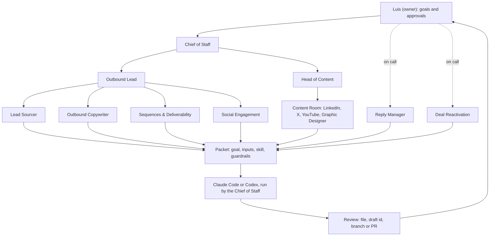

# Dreamstate GTM team

**Start here if you are new:** [docs/start-here.md](docs/start-here.md) is the plain-language map of this team. It says what each seat does, who you talk to, who talks to who, and what you do in the first week.

**Thirteen Grok Bots run outbound and content on Dreamstate, with Claude Code or Codex doing the actual work.**

**[Import the team →](setup-prompt.md)** · [The team](#the-team-you-get) · [How it flows](#how-it-flows) · [Rules](docs/rules.md) · [Claude Code and Codex](docs/claude-code-and-codex.md) · [Design playbook](docs/design-playbook.md)

Grok Bot holds the seats, one group chat and one routine. [Dreamstate](https://trydreamstate.com) holds the workspace: worksheets, sequences, the inbox, social drafts and Company Context, all through one MCP server at `https://mcp.trydreamstate.com/mcp`. Claude Code or Codex does the file work in a local repo. Each seat has one lane, and the department heads route instead of doing the work.

## Import the team

1. In Grok Bot, create a Bot named **Chief of Staff**.
2. Copy the block in **[the setup prompt](setup-prompt.md)** and send it as your first message.
3. Reply to the six questions it asks: company and offer, Dreamstate workspace, second brain, local repo and runtime, rollup time zone, and which seats to create.
4. It builds the seats, the Content Room and the 08:00 routine, then lists anything the app refused and the click left for you.

Setup connects, sends and spends nothing. To build by hand, paste the Charter block from each file in [seats/](seats/).

## The team you get

| Seat | Reports to | Lane |
|---|---|---|
| [Chief of Staff](seats/01-chief-of-staff.md) | Owner | Leads the team; runs each Claude Code or Codex packet |
| **Outbound** | | |
| [Outbound Lead](seats/02-outbound-lead.md) | Chief of Staff | Briefs, routing, gates, the weekday 08:00 rollup |
| [Lead Sourcer](seats/03-lead-sourcer.md) | Outbound Lead | Cold worksheets, warm rows from engagers and signups |
| [Outbound Copywriter](seats/04-outbound-copywriter.md) | Outbound Lead | First-touch email and LinkedIn sequence copy |
| [Sequences & Deliverability](seats/05-sequences-deliverability.md) | Outbound Lead | Builds sequences, watches mailbox and domain health |
| [Social Engagement](seats/06-social-engagement.md) | Outbound Lead | Watchlist, engagement targets, comment drafts |
| **On call** | | |
| [Reply Manager](seats/07-reply-manager.md) | Owner | Reply drafts in live threads |
| [Deal Reactivation](seats/08-deal-reactivation.md) | Owner | Ranks quiet deals, drafts one follow-up each |
| **Content** | | |
| [Head of Content](seats/09-head-of-content.md) | Chief of Staff | Weekly plan, routed to the writers |
| [LinkedIn Writer](seats/10-linkedin-writer.md) | Head of Content | LinkedIn posts and articles, plus Instagram and Facebook |
| [X Writer](seats/11-x-writer.md) | Head of Content | X posts, threads, Articles, plus Threads and TikTok |
| [YouTube Writer](seats/12-youtube-writer.md) | Head of Content | Titles, thumbnail brief, description, chapters |
| [Graphic Designer](seats/13-graphic-designer.md) | Head of Content | Graphics, thumbnails, carousels, rendered in Dreamstate |
| [Content Room](seats/14-content-room.md) | | Group chat for the content seats, pointers only |

Graphics are HTML, CSS, or SVG stored in Dreamstate. A GIF or MP4 is optional. The shared brand form at `design/brand.md` is blank. Each team fills a local copy. The steps in [docs/design-playbook.md](docs/design-playbook.md) are optional.

## How it flows

Outbound and content state lives in Dreamstate. Files live in the local repo. Every result comes back to the owner for a yes before anything goes out.

## How work runs

- **The packet.** A seat with something to build passes the Chief of Staff four fields: Goal, Inputs, Skill, Guardrails. It runs them as one task in Claude Code or Codex: content and design on the owner's Mac, code on an always-on server over SSH, one git worktree per task. Details in [docs/claude-code-and-codex.md](docs/claude-code-and-codex.md).
- **Consent.** No send, post, enrollment, launch, payment or deletion happens without the owner's yes on that exact item. Paid calls dry-run first and show the credits.
- **Lanes.** Heads plan, route and gate. Each seat uses only its own row of tools in [docs/rules.md](docs/rules.md).
- **One routine.** Weekdays at 08:00 the Outbound Lead collects the rollup. The Chief of Staff then sends the owner the decisions waiting, with links. Nothing else is scheduled.

## License

[MIT](LICENSE). Copyright 2026 Luis Figueroa Vale / Dreamstate.
