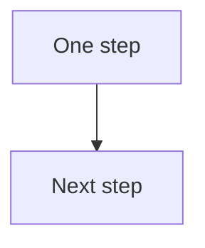

# Design playbook

Steps for the Graphic Designer. Use the owner's style from the local brand files. Do not invent a look those files do not state. The seat charter and [rules.md](rules.md) still apply.

The brand folder is required before a design. The templates, the diagram step, and the motion step stay optional.

A source is the HTML, CSS, or SVG you can edit. A render is a PNG or PDF made from that source. A CSS variable is a named value, such as a color, that a template can read. Your values live only in the local brand copy.

This repo is for any team. It ships no brand colors, fonts, or logo rules. Do not put a company's values in a committed file. Do not paste Company Context into one. Company Context is the pages in that team's own Dreamstate workspace.

## 1. Brand folder, required

Read [brand/AGENTS.md](../brand/AGENTS.md) first. The shared files in `brand/` are blank templates. The filled copy is `brand.local/`, with the same file names. That folder is in `.gitignore`. `work/` is for renders, not for a second brand copy.

Required before you design:

- `brand.local/identity.md`
- `brand.local/voice.md`
- `brand.local/style.md`
- `brand.local/tokens.css`

When the piece uses a logo, a photo, or an icon, `brand.local/assets/README.md` must list that file. If a required file is missing or a required line is blank, stop and ask the owner. Never guess.

You can read your own Tone of Voice page, Product Information page, and thumbnail preferences (`workspace.thumbnail_preferences_get`) while the owner fills the local copy. Write the values only there. If a page does not state a value, leave the line blank. Do not invent a brand color.

Templates import `brand/tokens.css` and `brand.local/tokens.css`. The shared CSS file sets nothing. Mirror the values from `brand.local/style.md` into `brand.local/tokens.css`. When you store the source in Dreamstate, copy the variables you are using into that file's own style block. Do not commit those values back to `brand/tokens.css`.

A clear background, the browser's text color, or a generic sans-serif is not a brand. Do not hand the owner a design that only has those fallbacks.

Before the work goes to the owner, run [brand/taste.md](../brand/taste.md).

## 2. Templates, if you want a starter

`design/templates/` holds a few HTML starters. Each one imports `brand/tokens.css` and `brand.local/tokens.css`. Until the local CSS file sets a variable, the frame uses a clear background, the browser's text color, and a generic sans-serif. Those are not a brand. Do not ship a frame that only has them.

| File | Starter size | What it is |
|---|---|---|
| `linkedin-carousel-slide.html` | 1080×1350 | One carousel slide |
| `single-image-square.html` | 1080×1080 | One square image |
| `single-image-wide.html` | 1200×627 | One wide image |
| `quote-stat-card.html` | 1080×1080 | A quote or a figure |
| `youtube-thumbnail.html` | 1280×720 | A thumbnail frame |
| `diagram-frame.html` | 1280×720 | A frame for an SVG |
| `infographic-steps.html` | 1080×1350 | Numbered steps. The still and the motion are the same file. |

The sizes are starters you can change. They are not platform rules. You can start from a template, or you can build your own frame. A figure stays off the card unless you can name its source.

## 3. Match a reference, if you are given one

If the owner gives you a screenshot or an example post, you can match its layout: the columns, the crop, and which line is largest. Use the colors, type, and logo from `brand.local/style.md` and `brand.local/assets/`. If those files are blank, ask the owner. Do not invent colors to imitate the example.

Do not copy someone else's logo, photo, or illustration. Do not trace their files.

## 4. Diagrams, if you want Mermaid

You can write the flow as Mermaid, render it to SVG on the owner's Mac with mermaid-cli, and paste the SVG into `diagram-frame.html` or a frame of your own. Keep the Mermaid text in the local checkout. Diagrams stay on that machine. Do not let lines cross or cover one another. If a draft crosses, change the layout and render again.

A small example that does not cross:



You can draw a diagram another local way. The same two rules apply: it stays local, and lines do not cross or cover each other.

## 5. Work one frame at a time, if that helps

You can finish one slide or one frame, then the next. The charter still asks you to review a render at its export size, then again at phone width, before you treat it as ready. This repo does not name the phone width in pixels. Use the width in `brand.local/style.md` if the owner wrote one. If the line is blank, ask the owner. Do not invent a pixel width.

## 6. A GIF or MP4, if you want motion

This is optional. Start from a static HTML source the owner has already accepted. Drive the motion with a JavaScript timeline in that same file. The timeline moves the HTML, CSS, and SVG already there. CSS holds the layout. It does not run the motion by itself. Keep the motion simple: a reveal, a counter, or a build that shows one step at a time.

On the owner's Mac, Codex can open the file in headless Chrome or Playwright and save a PNG for each frame. Then ffmpeg can make the video files.

An MP4 in H.264, from frames named `frame-001.png` and so on:

```sh
ffmpeg -y -framerate 24 -i frames/frame-%03d.png \
  -c:v libx264 -pix_fmt yuv420p -movflags +faststart output.mp4
```

A GIF that uses a palette, so the file stays smaller:

```sh
ffmpeg -y -i output.mp4 -vf "fps=10,scale=iw:-1:flags=lanczos,palettegen" palette.png
ffmpeg -y -i output.mp4 -i palette.png \
  -lavfi "fps=10,scale=iw:-1:flags=lanczos[x];[x][1:v]paletteuse" output.gif
```

Make the loop clean. The last frame should meet the first without a jump. Put the key message in the first frame. Always keep a still PNG of that same source as the fallback. Check the still and the motion at phone width.

These export settings are a starting point, not a LinkedIn rule. This page does not cite a LinkedIn help page. Mark each one to-check before you rely on it:

- Duration: start near 5 seconds. To-check.
- GIF frame rate: 10 frames a second in the command above. To-check.
- MP4: H.264 at 24 frames a second in the command above. To-check.
- File size: try to stay under about 2 MB for the GIF and about 5 MB for the MP4. To-check.

If the owner wrote different numbers in `brand.local/style.md`, use those instead. If you are unsure, leave the item marked to-check and ask.

For a numbered infographic, use the scripts in `design/scripts/` instead of the sample commands above. Those scripts use a different working frame rate. That rate is also to-check. Do not treat either set of numbers as a platform rule.

## An infographic, if you want one

The steps are in [infographic-rules.md](infographic-rules.md). They are optional. Read [brand/AGENTS.md](../brand/AGENTS.md) first. Run [brand/taste.md](../brand/taste.md) before the piece goes to the owner.

The Head of Content accepts the words before you draw. You do not invent a line or a number. You do not write the caption that ships.

The starter is `design/templates/infographic-steps.html`. It is 1080 by 1350. The still and the motion come from that one file. A script in the file is the timeline. It seeks to a time in milliseconds. Pieces arrive in reading order, and the full build, including the closing line, is on screen by about 2.3 seconds. A gentle loop of about 6 seconds follows, and that loop starts and ends on the same pose. The still PNG is the final frame of that build, from the same seek. `design/scripts/render-png.mjs` and `design/scripts/capture-frames.mjs` call that seek. Export the motion only after the owner has accepted that still. A GIF of the motion may open on an empty frame so the build can play again. The still PNG stays as the fallback.

On the owner's Mac:

- `design/scripts/render-png.mjs` writes a still PNG at 1× and at 2×.
- `design/scripts/capture-frames.mjs` writes frames and a filmstrip.
- `design/scripts/export-motion.mjs` writes an MP4, a GIF, and a PNG fallback.

Look at the filmstrip and at phone width. The script does not approve the piece. The owner is the final reviewer. Sizes and frame rates in the infographic rules are working numbers. To-check. They are not platform rules.

## 7. The source is what you keep

Deliver the HTML or SVG source, the PNG or PDF, and the GIF or MP4 when you made one. Store the source with `social.visuals.source_create` (HTML, CSS, or SVG). Read it back with `social.visuals.source_get` and `social.visuals.source_list`. Render with `social.visuals.render_preview`, then `social.visuals.render_start` (PNG or PDF, including a phone-width check), then `social.visuals.render_get` and `social.visuals.download_url`.

A re-render starts from that source. Do not redraw from the PNG.

## 8. Approval

Attach the PNG, or the GIF or MP4 when you made one, with `social.content.media_upload_url` and `social.content.media_uploaded`. That attach can clear an earlier approval, so ask again before any schedule. Nothing is posted or scheduled without the owner's yes on that exact item. If the text, the media, or the schedule changes after a yes, ask again.

## Guardrails that always apply

These come from the seat charter and the rules. They are not optional.

- Portrait pixels come only from photos the owner supplied. Do not generate, retouch, or replace the owner's face or body.
- No metric on an image unless you can name the source.
- Google Drive is read-only, for photos the owner stored.
- Do not write the caption that ships.
- Do not commit `brand.local/` or anything under `work/`. The shared files in `brand/` stay blank.

## Tools on the Mac

Content and design run on the owner's Mac. You need these only if you choose the matching step:

- mermaid-cli, if you render a diagram from Mermaid.
- Playwright or headless Chrome, if Codex captures frames. The infographic scripts use Playwright.
- ffmpeg, if you export an MP4 or a GIF. `design/scripts/export-motion.mjs` calls it.

Skip the tools you do not use.
