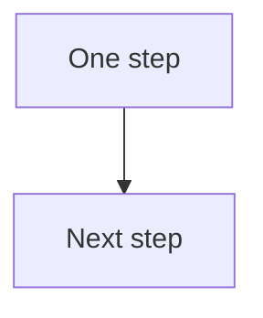

# Design playbook

Optional steps for the Graphic Designer. Use your own style. Nothing in this page is forced. The seat charter and [rules.md](rules.md) still apply when you do the work.

A source is the HTML, CSS, or SVG you can edit. A render is a PNG or PDF made from that source. A CSS variable is a named value, such as a color, that a template can read. Your values live only in a local file.

This repo is for any team. It ships no brand colors, fonts, or logo rules. Do not put a company's values in a committed file. Do not paste Company Context into one. Company Context is the pages in that team's own Dreamstate workspace.

## 1. Brand rules, if you want them

`design/brand.md` is a blank form. Copy it to `design/brand.local.md` in your checkout, or put the copy under `work/`. Fill the copy. Both paths are in `.gitignore`.

The form has places for colors, fonts, type sizes, spacing, logo usage, and safe margins. You can read your own Tone of Voice page, Product Information page, and thumbnail preferences (`workspace.thumbnail_preferences_get`) while you fill the local copy. Write the values only there. If a page does not state a value, leave the line blank. Do not invent a brand color.

If you want the templates to use those values, put them in `design/tokens.local.css` under the names in `design/tokens.css`. That CSS file is gitignored. The shared `design/tokens.css` sets nothing.

You can skip the brand file and style each piece yourself.

## 2. Templates, if you want a starter

`design/templates/` holds a few HTML starters. Each one reads the CSS variables. Until your local CSS file sets a variable, the frame uses a clear background, the browser's text color, and a generic sans-serif. Those are not a brand.

| File | Starter size | What it is |
|---|---|---|
| `linkedin-carousel-slide.html` | 1080×1350 | One carousel slide |
| `single-image-square.html` | 1080×1080 | One square image |
| `single-image-wide.html` | 1200×627 | One wide image |
| `quote-stat-card.html` | 1080×1080 | A quote or a figure |
| `youtube-thumbnail.html` | 1280×720 | A thumbnail frame |
| `diagram-frame.html` | 1280×720 | A frame for an SVG |

The sizes are starters you can change. They are not platform rules. You can start from a template, or you can build your own frame. A figure stays off the card unless you can name its source.

## 3. Match a reference, if you are given one

If the owner gives you a screenshot or an example post, you can match its layout: the columns, the crop, and which line is largest. Use your own colors, type, and logo from the local brand file. If that file is blank, ask the owner. Do not invent colors to imitate the example.

Do not copy someone else's logo, photo, or illustration. Do not trace their files.

## 4. Diagrams, if you want Mermaid

You can write the flow as Mermaid, render it to SVG on the owner's Mac with mermaid-cli, and paste the SVG into `diagram-frame.html` or a frame of your own. Keep the Mermaid text in the local checkout. Diagrams stay on that machine. Do not let lines cross or cover one another. If a draft crosses, change the layout and render again.

A small example that does not cross:



You can draw a diagram another local way. The same two rules apply: it stays local, and lines do not cross or cover each other.

## 5. Work one frame at a time, if that helps

You can finish one slide or one frame, then the next. The charter still asks you to review a render at its export size, then again at phone width, before you treat it as ready. This repo does not name the phone width in pixels. Use the width in your local brand file if you wrote one. If the line is blank, ask the owner. Do not invent a pixel width.

## 6. A GIF or MP4, if you want motion

This is optional. Start from a static HTML source the owner has already accepted. Animate that same source with CSS keyframes. Keep the motion simple: a reveal, a counter, or a build that shows one step at a time.

On the owner's Mac, Codex can open the file in headless Chrome or Playwright and save a PNG for each frame. Then ffmpeg can make the video files.

An MP4 in H.264, from frames named `frame-001.png` and so on:

```sh
ffmpeg -y -framerate 24 -i frames/frame-%03d.png \
  -c:v libx264 -pix_fmt yuv420p -movflags +faststart output.mp4
```

A GIF that uses a palette, so the file stays smaller:

```sh
ffmpeg -y -i output.mp4 -vf "fps=10,scale=iw:-1:flags=lanczos,palettegen" palette.png
ffmpeg -y -i output.mp4 -i palette.png \
  -lavfi "fps=10,scale=iw:-1:flags=lanczos[x];[x][1:v]paletteuse" output.gif
```

Make the loop clean. The last frame should meet the first without a jump. Put the key message in the first frame. Always keep a still PNG of that same source as the fallback. Check the still and the motion at phone width.

These export settings are a starting point, not a LinkedIn rule. This page does not cite a LinkedIn help page. Mark each one to-check before you rely on it:

- Duration: start near 5 seconds. To-check.
- GIF frame rate: 10 frames a second in the command above. To-check.
- MP4: H.264 at 24 frames a second in the command above. To-check.
- File size: try to stay under about 2 MB for the GIF and about 5 MB for the MP4. To-check.

If the owner wrote different numbers in the local brand file, use those instead. If you are unsure, leave the item marked to-check and ask.

## 7. The source is what you keep

Deliver the HTML or SVG source, the PNG or PDF, and the GIF or MP4 when you made one. Store the source with `social.visuals.source_create` (HTML, CSS, or SVG). Read it back with `social.visuals.source_get` and `social.visuals.source_list`. Render with `social.visuals.render_preview`, then `social.visuals.render_start` (PNG or PDF, including a phone-width check), then `social.visuals.render_get` and `social.visuals.download_url`.

A re-render starts from that source. Do not redraw from the PNG.

## 8. Approval

Attach the PNG, or the GIF or MP4 when you made one, with `social.content.media_upload_url` and `social.content.media_uploaded`. That attach can clear an earlier approval, so ask again before any schedule. Nothing is posted or scheduled without the owner's yes on that exact item. If the text, the media, or the schedule changes after a yes, ask again.

## Guardrails that always apply

These come from the seat charter and the rules. They are not optional.

- Portrait pixels come only from photos the owner supplied. Do not generate, retouch, or replace the owner's face or body.
- No metric on an image unless you can name the source.
- Google Drive is read-only, for photos the owner stored.
- Do not write the caption that ships.
- Do not commit `design/brand.local.md`, `design/tokens.local.css`, or anything under `work/`.

## Tools on the Mac

Content and design run on the owner's Mac. You need these only if you choose the matching step:

- mermaid-cli, if you render a diagram from Mermaid.
- Playwright or headless Chrome, if Codex captures frames.
- ffmpeg, if you export an MP4 or a GIF.

Skip the tools you do not use.
