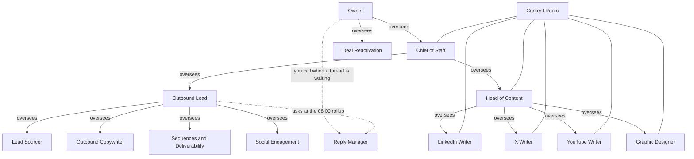

# Start here

This page is for the owner. You do not need any background. The facts come from the seat files in `seats/`, the [README](../README.md), [docs/rules.md](rules.md), [docs/claude-code-and-codex.md](claude-code-and-codex.md), and [setup-prompt.md](../setup-prompt.md). If those files do not say something, this page calls it an open item.

A seat is one Grok Bot with one job. A charter is the written job in that seat's file. A yes is your approval of one named thing, such as one draft or one list.

## What this team is

This is a Grok Bot team that drafts outbound and content on Dreamstate, the workspace that holds the pages, the tables, the sequences (a timed series of emails and notes), and the drafts. A seat is one Grok Bot with one job, and the desk is the Chief of Staff plus twelve seats, plus a Content Room that is a group chat and not a bot. The bots draft, and they do not send, post, enroll (put people into a sequence), or spend until you say yes to that named thing. Claude Code and Codex edit files in a local repo while the bots stay in Grok Bot, and one weekday routine at 08:00 in your time zone brings you a morning note.

Company Context is the second brain. It is the pages the seats read so they stay on the offer, the customer, and the voice. The one connection a bot uses to reach Dreamstate is `https://mcp.trydreamstate.com/mcp`. One server. You sign in through the browser. You do not paste an API key.

## What each seat does

Outbound reports to the Outbound Lead. Content reports to the Head of Content. Both report to the Chief of Staff. The Chief of Staff answers to you.

### Chief of Staff

The Chief of Staff runs the desk. It runs each work packet. A packet is four fields: the goal (what finished looks like), the inputs (pages, rows, or files), the skill (the instruction name the coding agent reads), and the guardrails (what must not happen). It hands that packet to Claude Code or Codex. It uses the diagnostics skill when a run is stuck. It uses first-win only when you ask after setup, and that call sends nothing. The charter does not describe first-win beyond that. After the 08:00 note, it sends you the decisions that are waiting, with links. It names the reads it finished and the ones it left. The Outbound Lead and the Head of Content set the order inside their own lanes. It never takes a specialist's lane. Full charter: [seats/01-chief-of-staff.md](../seats/01-chief-of-staff.md).

### Outbound Lead

The Outbound Lead plans outbound and keeps the gate. A gate is the stop before paid work. It owns the outbound brief. A brief is the outcome, the ideal customer, the offer, a short campaign code, the audience cap, the credit ceiling, and the worksheet name. A campaign code is the short name used to group the work. The audience cap is the most people that campaign may include. The credit ceiling is the most credits it may spend. Credits are what Dreamstate charges for a paid lookup. You approve the brief before any paid lookup. It owns the weekday 08:00 rollup when the app allows that. A rollup is the one morning note. It asks the Reply Manager, Social Engagement, Sequences & Deliverability, the Outbound Copywriter, and the Lead Sourcer. It hands lists to the Lead Sourcer, wording to the Outbound Copywriter, the sequence build to Sequences & Deliverability, and comments to Social Engagement. It hands the Chief of Staff the goal, the inputs, the skill, and the guardrails. When you ask what to run next, it reads the `plays` skill and recommends the one play that skill returns. That recommendation does not start a send. It never sources, writes the copy, loads a sequence, comments, or answers a thread. Live threads stay with the Reply Manager. Quiet deals stay with Deal Reactivation. Full charter: [seats/02-outbound-lead.md](../seats/02-outbound-lead.md).

### Lead Sourcer

The Lead Sourcer builds cold worksheets and scores warm rows. A worksheet is a table in Dreamstate. A row is one person or company on that table. A cold worksheet is a new list, and it needs your approved brief. A warm row is someone scored from a sign the charter names. Those sources are LinkedIn engagers and followers, signups already on a worksheet or in the CRM (the contact and deal records), people the X read tools return, and `tables.x_post_engagers.run`. That last call costs 0 credits and still calls X, so it needs a yes first. It tags the worksheet with the campaign code and stays inside the cap and the ceiling. It scores only from evidence. A comment ranks above a like, a repeat above a one-off, a recent event above an old one, and a signup or a booking above neither. Missing facts stay unknown. It hands the Chief of Staff the brief, the quote, the worksheet, the skill, and the guardrails. A quote is the price a dry run shows before the live call. A dry run is a practice call that shows the rows, the credits, and a quote id, and then waits. It never enrolls and it never messages. It has no routine of its own. Recent demos stay with Deal Reactivation. Full charter: [seats/03-lead-sourcer.md](../seats/03-lead-sourcer.md).

### Outbound Copywriter

The Outbound Copywriter writes the first cold email and the LinkedIn notes inside a sequence. It writes from an approved brief: who it is for, the offer, the angle, the steps, and columns that already exist on the worksheet. It reads Product Information, Ideal Customer, and Tone of Voice, and it names those pages. A proof line, a customer, a metric, or a product claim stays out unless a page or a column contains it. It keeps each note short, specific, and non-salesy. When the brief asks for a test, it writes a pair of options, and each step needs fallback copy. It does not use `{{first_name}}`, because that token will not resolve at send time. It stops before enrollment. It passes the accepted text to the Outbound Lead and to Sequences & Deliverability. It hands the Chief of Staff the brief, the worksheet, the angle, the skill, and the guardrails. The guardrails are draft only, and no enrollment. It never enrolls, sends, or writes public posts. It has no routine of its own. Full charter: [seats/04-outbound-copywriter.md](../seats/04-outbound-copywriter.md).

### Sequences & Deliverability

Sequences & Deliverability builds a sequence from accepted copy and accepted rows. It puts the campaign code in the sequence name. Creating the campaign is a free draft. It sets a daily cap on new enrollments for every sequence it builds. It shows you each step, its fallback copy, the audience count, the sender, and the pace. People already in an open thread stay out unless you name those rows. It also watches mailbox and domain health and reports that in the morning rollup. Bounce and unsubscribe counts on the live sequence are unavailable, so it treats them as unknown. It hands the Chief of Staff the accepted worksheet, the accepted wording, the skill, and the guardrails. It never writes copy and it never sources rows. It has no routine of its own. It does not change a live sequence unless you approve that edit. A launch, an activation, and a resume each need their own yes. Full charter: [seats/05-sequences-deliverability.md](../seats/05-sequences-deliverability.md).

### Social Engagement

Social Engagement keeps a watchlist and drafts comments. The watchlist is a worksheet: who, why, and the post URL a tool returned. It drafts the comment from Tone of Voice and shows the account, the post URL, and the full text. Publishing a comment costs 2 credits and is public. A like, a comment, or a repost also needs a yes on that action. A reply to a comment on your own post waits for a yes too. When you ask for warm-signal rows, it hands the sheet to the Lead Sourcer and does not enroll it. It hands the Chief of Staff the posts, the worksheet, the skill, and the guardrails. It never enrolls a sequence and it never publishes your posts. It has no routine of its own. Full charter: [seats/06-social-engagement.md](../seats/06-social-engagement.md).

### Reply Manager

The Reply Manager drafts replies in LinkedIn threads that already exist, and in email when you name that thread. It reports open threads to the 08:00 rollup. It takes threads that need a human reply. It checks that the sequence is stopped before it drafts. If the sequence is active or the stop state is unknown, it says so and does not offer a send. One draft at a time. A digest is at most 10 threads. It shows the channel, the account, the recipient, and the final text together. Voice for a reply: answer their last message, usually under 240 characters, one next step, no meeting push unless they asked, never paste a suggested reply, and match their language. It hands the Chief of Staff the threads, the skill, and the guardrails. The guardrails are draft only. You approve each draft by name. It never writes a cold first touch or a public post. It has no routine of its own. Its charter does not name a boss. That is an open item. Full charter: [seats/07-reply-manager.md](../seats/07-reply-manager.md).

### Deal Reactivation

Deal Reactivation finds quiet past deals and drafts one follow-up. It answers to you. It reads the deal board, the forecast, the sales-cycle position, inbox threads, meetings, and any signup worksheet you named. It ranks from evidence it can point at: stated pain, a dated timeline, budget or who can buy, a signup, or a booking that followed the call, plus replies from the last few days. It prefers a lead likely to close in 1 to 2 weeks. A quote, an amount, or a fact it cannot point at stays unknown. You get one short draft for each lead it ranks first, with the recipient, the channel, and the text. If you want a sequence for that lead, it hands the sequence to the Outbound Lead. It hands the Chief of Staff the lead, the evidence, the skill, and the guardrails. The guardrails are draft only. It never sends. It never moves a deal to another stage. A stage is the deal's step, such as open or won. It never writes a CRM field, a Notion page, or a task status unless you say OK. It has no routine of its own. Live reply threads stay with the Reply Manager. Full charter: [seats/08-deal-reactivation.md](../seats/08-deal-reactivation.md).

### Head of Content

The Head of Content sets the week's plan and routes each item. It reads Product Information, Ideal Customer, and Tone of Voice. It plans LinkedIn, X, and YouTube from those pages. Each item has a channel, an angle, a source, a seat, a deadline, and the proof it may use. LinkedIn, and also Instagram and Facebook, go to the LinkedIn Writer. X, and also Threads and TikTok, go to the X Writer. The video package goes to the YouTube Writer. The image goes to the Graphic Designer. Reddit only when you ask. It then uses the Reddit skill, and you post it. It marks a day with the plan tool. Clearing that mark is not a schedule. A schedule is a later yes that sets a post to go out. YouTube items are drafts. YouTube and Threads stay drafts until an account is connected. It hands the Chief of Staff the goal, the inputs, the skill, and the guardrails. It never writes the final post, the package, or the image. The weekday trend brief stays off unless you say you will read it each weekday morning. Full charter: [seats/09-head-of-content.md](../seats/09-head-of-content.md).

### LinkedIn Writer

The LinkedIn Writer drafts LinkedIn posts, opening lines, and articles. When the Head of Content assigns them, it also drafts Instagram and Facebook, and those stay drafts until you name that account. It drafts a LinkedIn article only when native articles are turned on for the account. If that switch is off, it skips the article call. Voice comes from Tone of Voice and from posts the social tools return. A metric, a customer, or a product claim needs a source it opened. It saves the draft on the LinkedIn account you named. If more than one LinkedIn account is connected and you did not pick, it asks. It hands the Chief of Staff the goal, the inputs, the skill, and the guardrails, and it reads the file that comes back before it treats the work as finished. It never writes X, YouTube, or inbox replies. It has no routine of its own. Schedule and publish wait for a yes on that draft. Full charter: [seats/10-linkedin-writer.md](../seats/10-linkedin-writer.md).

### X Writer

The X Writer drafts X posts, threads, and replies. When the Head of Content assigns them, it also drafts TikTok, and Threads posts. Threads stays a draft until an account is connected. One idea that fits in one post stays one post. A number or a proof line stays out unless the source material contains it. It writes an X Article only when native articles are turned on. If that switch is off, it does not call the article tools. Opening article delivery is outward and needs a yes. Picks and cuts go through the Head of Content plan and feedback tools. It hands the Chief of Staff the goal, the inputs, the skill, and the guardrails. The live X account stays quiet until you name one action. It never posts, likes, follows, or sends a direct message through X. It has no routine of its own. Schedule and publish wait for a yes on that draft. Its charter does not say it reads the Tone of Voice page. That is an open item. Full charter: [seats/11-x-writer.md](../seats/11-x-writer.md).

### YouTube Writer

The YouTube Writer packages a video: title options, a thumbnail brief, a description, and chapters. It saves that package as a YouTube draft. It reads Tone of Voice and Product Information. Chapters come from a transcript you supply. Footage is read from Google Drive or from local files. The Graphic Designer makes the thumbnail image. It hands the Chief of Staff the goal, the inputs, the skill (`youtube-posts`), and the guardrails. The guardrails are no upload, no new numbers, and no generated face or body. A view count or a proof line stays out unless you supplied it. It never uploads. Connect, upload, and outlier research stay on your machine. The files do not name the local upload tool. That is an open item. It has no routine of its own. The package stays a draft until an account is connected. Full charter: [seats/12-youtube-writer.md](../seats/12-youtube-writer.md).

### Graphic Designer

The Graphic Designer builds social graphics, thumbnail frames, carousels, and diagrams. Dreamstate stores the editable source as HTML, CSS, or SVG, renders a PNG or PDF, and can read that source back. Diagrams stay on your machine. The files do not name the local diagram tool. That is an open item. It reads Tone of Voice, when that page exists, and your thumbnail preferences before it draws. It reviews the render at export size and again at phone width. It attaches the PNG to a social draft. That attach can clear an earlier approval, so it asks again before any schedule. It hands the Chief of Staff the brief, the photo files, the skill, and the guardrails. It delivers the editable source and the PNG or PDF. Portrait pixels come only from photos you supplied. It never generates, retouches, or replaces your face or body. No metric on an image unless it can name the source. It never writes the caption that ships. It has no routine of its own. Full charter: [seats/13-graphic-designer.md](../seats/13-graphic-designer.md).

### Content Room

The Content Room is not a seat. It has no Dreamstate login of its own. It is the shared chat for the content lane. The members are the Graphic Designer, the YouTube Writer, the X Writer, the LinkedIn Writer, the Head of Content, and the Chief of Staff. It holds pointers only: the channel, the angle, a file path or draft id, and the deadline. A pointer is a note about where the work is. The draft lives in a social draft, or in the local repo when that seat's charter says the step stays local. It never publishes, schedules, enrolls, or spends. A publish still needs the yes in the rules, from the seat that owns the channel. Add nobody else unless you edit [seats/14-content-room.md](../seats/14-content-room.md).

There are no other seats in `seats/`.

## Who you talk to

You talk mainly to the Chief of Staff. It answers to you. It runs the desk, hands file work to the coding agents, and sends you the decisions after the morning note.

You go to the Outbound Lead for the outbound lane. It reports to the Chief of Staff. It plans the work and holds the brief until you approve it. You do not have to brief the Lead Sourcer, the Outbound Copywriter, Sequences & Deliverability, or Social Engagement one by one. The Outbound Lead routes them.

You go to the Head of Content for the content lane. It reports to the Chief of Staff. It sets the week's plan and routes each item to a writer. You do not have to brief the LinkedIn Writer, the X Writer, the YouTube Writer, or the Graphic Designer one by one.

You call the Reply Manager when a LinkedIn thread already exists, or when you want a reply in an email thread you name. You call Deal Reactivation when you want quiet past deals looked at. Deal Reactivation answers to you. The Reply Manager's charter does not name a boss. Neither seat has a routine of its own. Deal Reactivation runs when you ask. The Reply Manager runs when you ask, and the Outbound Lead also asks it during the 08:00 rollup, because that seat owns live threads.

## Who talks to who

A solid arrow means the upper box oversees the lower one. A dotted arrow means a call or a morning question. The labels say what the files actually allow.

Reporting lines the files name:

- The Chief of Staff answers to you.
- The Outbound Lead reports to the Chief of Staff.
- The Lead Sourcer, the Outbound Copywriter, Sequences & Deliverability, and Social Engagement report to the Outbound Lead.
- The Head of Content reports to the Chief of Staff.
- The LinkedIn Writer, the X Writer, the YouTube Writer, and the Graphic Designer report to the Head of Content.
- Deal Reactivation answers to you. Quiet deals stay with it. If you want a sequence for one of those leads, it hands that job to the Outbound Lead.
- The Reply Manager's file does not say who it reports to. Open item. What the file does say: it reports open threads into the 08:00 rollup, the Outbound Lead asks it then, and it owns live threads.

The Content Room is a group chat. It has no seat above it and no seat under it. The six members are in the diagram. Outbound seats are outside the room. The room holds pointers. The draft lives elsewhere, and the room does not publish.

### The weekday 08:00 rollup

A routine is one scheduled run. This desk has exactly one: weekdays at 08:00 in your time zone. No second routine, and no Dreamstate recurring trigger, unless you say yes to that extra run.

The app decides who can own a routine.

- When the app allows it, the Outbound Lead owns the 08:00 run and collects the note.
- When the app lets only the Chief of Staff own routines, the Chief of Staff owns the run. The text of that run tells the Outbound Lead to collect the note and return it. That text is the ping.

Either way, the Outbound Lead asks five seats: the Reply Manager, Social Engagement, Sequences & Deliverability, the Outbound Copywriter, and the Lead Sourcer. It groups the answers by campaign code. It lists rows a tool counted, credits those lookups cost, what is blocked, and which decisions need you. If a seat does not report, the note says unknown. It does not write zero. The note does not enroll, send, or spend.

The files do not put Deal Reactivation or the content seats on this rollup. Open item if you wanted them in the morning note.

After the note, the Chief of Staff sends you the decisions that are waiting, with links. It names the reads it finished and the ones it left.

### How a packet reaches Claude Code or Codex

A seat passes the packet to the Chief of Staff. The Chief of Staff runs those four fields as one task. Claude Code or Codex is the coding agent that edits the files. The seats stay in Grok Bot.

The run uses one git worktree per task, inside tmux. A worktree is a separate checkout so two tasks do not edit the same folder. Tmux is a session you can leave and come back to. You can attach to that session. Of the two subscriptions, the run uses the one with more of its weekly allowance left. Content and design run on your Mac. Product and outbound code run on the always-on server over SSH. Logins stay on that server. The seat does not ask you for tokens in chat. When the task finishes, you get the path, the branch, or the pull request. A production change, a merge, and a deploy still wait for a yes. If Claude Code and Codex are both unavailable, the seat does the work itself under the same guardrails.

The instruction files for those agents come from [luisfigueroavale/dreamstate-plugins](https://github.com/luisfigueroavale/dreamstate-plugins). They are installed into the checkout. `skills_get` takes a bare id, such as `plays`. The `dreamstate` skill is read from `skills/dreamstate/SKILL.md` in that plugin repo. It is not loaded with `skills_get`.

Open item: this repo does not name the folder. Setup asks you for the local repo path, whether that path is on this machine or over SSH, and which of the two agents to prefer. A folder named `~/dreamstate-growth` is not in these files. Use the path you give at setup.

One example from the file-work guide: the goal is five X posts about a price change. The inputs are the Product Information page and three posts you already accepted. The skill is `x-posts`. The guardrail is no publish and no new numbers.

## What you do first

If the seats do not exist yet, run [setup-prompt.md](../setup-prompt.md) first. It asks six questions, then builds the desk. Setup itself must not connect a new app, send, post, enroll, launch, spend, or delete. Do the steps below in this order. The files require one workspace, the four pages before anyone writes them, and your yes before a connection, a paid lookup, or an enrollment.

1. Confirm the one workspace. The first call is `whoami`. If a different workspace is active, stop. This desk never opens a second workspace. This repo does not name the workspace. You pick it at setup.
2. Tell the desk the company name, the offer, and who it is for. Then write the four Company Context pages if they are missing: Product Information, Ideal Customer, Competitor Analysis, and Tone of Voice. Say what belongs on each page before anyone writes it. A page is written with `knowledge.brain.context.compose_pages`. That call starts as a dry run, which shows the price and writes nothing. Then you say yes. A markdown note uses `knowledge.vault.ingest`, and a second call duplicates the note, so do not ingest the same note twice.
3. Confirm the one Dreamstate connection, `https://mcp.trydreamstate.com/mcp`, and sign in through the browser. If a second server exists at `https://mcp.trydreamstate.com`, remove it. Do not paste an API key.
4. Name the local repo path for Claude Code or Codex. Say whether it is on this machine or over SSH, and which agent to prefer. Install the plugin skill files into that checkout. Do not add a second Dreamstate server while you do that.
5. Set the time zone for the one weekday routine at 08:00. Confirm there is no second routine. If the app put that routine on the Chief of Staff, the routine text must tell the Outbound Lead to run the rollup and return the note.
6. Connect the senders and mailboxes you want. Starting a sender connection needs a yes. Turning on mailbox warmup needs a yes. Auto-enrolling a mailbox for deliverability needs a yes. Buying a mailbox is a charge: you get a quote, then you decide. A placement test sends a real probe email and needs a yes even when the credit price is 0. This repo does not say which mailbox vendor to use or how many mailboxes to connect. That is an open item.
7. Approve the first outbound brief before any paid lookup. Then approve the first lead list and its credit quote. Do not enroll yet. The lead section below is the full path.
8. Tell the Head of Content which channels you want this week, and whether you will read a trend brief each weekday morning. If you do not say you will read it, the brief stays off.
9. Read the drafts. Say yes only to the named send, post, enrollment, or launch. A yes on different wording is a new yes.

The Head of Content starts from Product Information, Ideal Customer, and Tone of Voice. Its charter does not mention mailboxes. Creating a sequence is a free draft. Before a launch, the seat still shows the sender, the audience count, and the pace, and the launch needs its own yes.

## How to set up the content plan

The Head of Content owns the week's plan. It does not write the final post.

Where it lives:

- It marks a day with `social.content.plan`. `social.content.unplan` clears that day. A marked day is not a schedule.
- Each item carries a channel, an angle, a source, a seat, a deadline, and the proof it may use.
- The Content Room holds the pointers: channel, angle, file path or draft id, and deadline.
- The draft lives in a social draft. YouTube packages live as drafts from `social.content.artifact_create`. A step the charter keeps local lives in the local repo.
- YouTube and Threads stay drafts until an account is connected.
- This repo does not define a Company Context page named "content plan." That is an open item. The plan is the marked days plus the pointers in the Content Room.

What you tell the Head of Content:

- The offer, the reader, and the voice are on Product Information, Ideal Customer, and Tone of Voice. It reads those three. Its charter does not say it reads Competitor Analysis. Who reads that page is an open item.
- Which channels you want. LinkedIn, X, and YouTube are the default plan. Instagram and Facebook go to the LinkedIn Writer when assigned. Threads and TikTok go to the X Writer when assigned. Reddit only if you ask, and you post it yourself.
- Whether you will read a trend brief every weekday morning.
- Which proof it may use. A metric, a customer, or a product claim has to already be on a page or in a source the writer opened.

How a yes moves:

- The Head of Content routes the item. The writer drafts it. The writer does not schedule or publish it.
- You say yes to that draft before it is scheduled or published. The yes comes through the seat that owns the channel.
- Bots never call the tool that authorizes a publish, and they never turn on auto-publish.
- If the text, the media, or the schedule changes after a yes, they ask again.
- When you pick or cut a post, the Head of Content records that with the post feedback tool or the version feedback tool. The X Writer does not keep a separate local log for picks and cuts.
- If the Graphic Designer attaches a new PNG, an earlier approval can clear. They ask again before any schedule.

## How to set up the writing style

Tone of Voice is one of the four Company Context pages. The other three are Product Information, Ideal Customer, and Competitor Analysis. Together they are the second brain. A page is written with `knowledge.brain.context.compose_pages`: dry run, then your yes. A markdown note is `knowledge.vault.ingest`, and a second call duplicates it. Revising a document uses `knowledge.brain.knowledge.compose_document`. Linking a GitHub repo so Dreamstate can read those files is `knowledge.repositories.connect`, then `knowledge.repositories.sync`. Both call GitHub and need a yes.

How each writer uses the pages:

- The Head of Content reads Product Information, Ideal Customer, and Tone of Voice before it plans.
- The Outbound Copywriter reads those same three and names them. A proof line, a customer, a metric, or a product claim stays out unless a page or a worksheet column contains it.
- The LinkedIn Writer takes voice from Tone of Voice and from posts the social tools return. A metric, a customer, or a product claim needs a source it opened.
- The YouTube Writer reads Tone of Voice and Product Information. A view count or a proof line stays out unless you supplied it.
- The Graphic Designer reads Tone of Voice, when the page exists, and your thumbnail preferences before it draws.
- Social Engagement drafts the comment from Tone of Voice.
- The X Writer's charter does not say it reads Tone of Voice. A number or a proof line still stays out unless the source contains it. Open item.
- The Reply Manager's charter does not say it reads Tone of Voice. It uses the reply rules in its charter: answer the last message, usually under 240 characters, one next step, no meeting push unless they asked, match their language. Open item.
- Deal Reactivation drafts from details in the record. Its charter does not name Tone of Voice. Open item.

How feedback sticks:

- Say the voice on the Tone of Voice page, then say yes to that write. That is the page the seats who name Tone of Voice are told to read.
- When you like or cut a post, tell the Head of Content. It records the pick or the cut with `social.content.post_feedback_record` or `social.content.version_feedback_update`.
- When you edit a reply and want that wording kept, the Reply Manager can save it with `knowledge.brain.context.compose_pages` only after you approve that write.
- The other writers are not told to write your edits back onto Tone of Voice. If you want a correction to apply next time, say yes to a write on that page. Open item: the files do not make that save automatic.
- If the text, the media, the audience, or the schedule changes after a yes, they ask again.

## How to set up leads

The Ideal Customer page is the reader the brief points at. The Outbound Lead puts that reader in the brief. The Lead Sourcer will not build a cold list without an approved brief. The Outbound Copywriter reads the Ideal Customer page before it writes.

The path:

1. You approve the brief before any paid lookup. The Outbound Lead holds that gate. The brief has the outcome, the ideal customer, the offer, a campaign code, an audience cap, a credit ceiling, and a worksheet name.
2. The Outbound Lead sends the list job to the Lead Sourcer. The Lead Sourcer builds the cold worksheet or scores warm rows, tags the worksheet with the campaign code, and stays inside the cap and the ceiling. Recent demos stay with Deal Reactivation.
3. The Lead Sourcer hands the Chief of Staff the brief, the quote, the worksheet, the skill, and the guardrails. The quote comes from a dry run. You see the rows, the credits, and the quote id (`quote_hash`). Then you decide.
4. You approve the list and the credit quote. The live lookup repeats that same quote id. This step does not enroll anyone and does not send.
5. The Outbound Lead sends the wording job to the Outbound Copywriter. The copywriter writes the first email and the LinkedIn notes, stops before enrollment, and passes the accepted text to the Outbound Lead and to Sequences & Deliverability.
6. The Outbound Lead sends the build to Sequences & Deliverability. It loads accepted copy and accepted rows only. Creating the campaign is a free draft. It shows each step, the fallback copy, the audience count, the sender, and the pace. It sets a daily cap on new enrollments. People already in an open thread stay out unless you name those rows.
7. You approve enrollment on its own. A launch, an activation, and a resume each need their own yes. Saying yes to activation approves the whole series for that audience. There is no lifetime cap on those sends. The files say this in [docs/rules.md](rules.md). Read that before you activate.

Where the leads live:

- On the worksheet named in the brief, in the one Dreamstate workspace. The campaign code is the tag on that worksheet, and it also goes in the sequence name.
- A signup can already sit on a worksheet or in the CRM. Other warm rows come from the sources named in the Lead Sourcer charter.
- Sequences & Deliverability loads only copy and rows the handoff calls accepted. Enrollment still needs its own yes.
- This repo does not name a second system of record for leads. It also does not name the worksheet columns. The copywriter can use only columns that already exist. That column list is an open item.

What you approve on this path: the brief, the list, the credit quote, and the enrollment. The files call the loaded wording "accepted text." They do not name a separate yes for that wording, apart from your yes before a send or an enrollment.

## What needs your yes

You say yes to the named object before a send, a post, an enrollment, a launch, a charge, or a deletion. A named object is that draft, that list, that sequence, or that charge. Each yes covers that object.

A paid call or an outward call starts as `tools_run` with `dry_run`. You see the rows, the credits, and the `quote_hash`, including when the list is under 25 rows. Then the seat waits. The live call repeats that quote id, sets `max_credits` (the most it may spend), and sends an idempotency key (the id the rules require on that live call). `max_credits` is 0 only when the quote is 0. The seat sets `approved` only after your yes. If a paid read cannot dry-run, the seat shows the listed price and waits.

Some actions cost nothing and still need a yes, because they leave the workspace. The rules include a mailbox placement test (it sends a probe), a LinkedIn invite, a connection invite, an engage action, creating a calendar event, a radar scan, an analytics refresh, and the call that reads who engaged with an X post. Some other actions do not raise an approval flag. The seat still names the object and waits. The full lists are in [docs/rules.md](rules.md).

Also waiting for your yes:

- Schedule a post. Bots never call the tool that authorizes a publish, and they never turn on auto-publish.
- A comment, a reaction, or a new post.
- Connect a sender, turn on warmup, or auto-enroll a mailbox for deliverability.
- Connect or sync a GitHub repo into the second brain.
- Write a CRM field, a Notion page, or a task status.
- Production, a merge, or a deploy.
- A second Grok Bot routine, or a Dreamstate recurring trigger.
- A new yes if the text, the media, the audience, or the schedule changes after the first yes.

Activating a sequence approves the whole series for that audience. Lifecycle and enrollment calls have no lifetime send ceiling.

The seats report only figures a tool returned. Unknown stays unknown. They do not generate, retouch, or replace your face or body.

## Open items

The files do not decide these. Do not treat a guess as a rule.

- The local repo path. You name it at setup. `~/dreamstate-growth` is not in this repo.
- The Dreamstate workspace name. You pick it at setup. `whoami` shows what is active.
- Who the Reply Manager reports to.
- Whether the X Writer, the Reply Manager, and Deal Reactivation read Tone of Voice. Their charters do not say they do.
- Which seat reads the Competitor Analysis page. The Head of Content charter names the other three pages only.
- A page titled "content plan." The plan is the marked days plus the Content Room pointers.
- Which mailbox vendor to use, and how many mailboxes to connect.
- The worksheet columns. Copy uses columns that already exist.
- A local tool name for YouTube connect and upload, and a local tool name for diagrams.
- An automatic write-back of your edits onto Tone of Voice. Only the Reply Manager is told to save edited reply text, and only after you approve that write.
- A morning rollup for content, or for Deal Reactivation. The 08:00 note asks five outbound seats. The weekday trend brief stays off unless you say you will read it.
